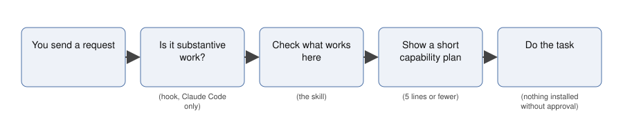

# Capability Scout

A skill that makes Claude check which tools actually work for a task, and say so, before it starts the task.

[](LICENSE)

**Status:** version 0.4.2. Last verification run: 2026-11-11 (live test in Claude Code 2.1.322, Sonnet 5.5 and Opus 5.5 requested by name; see [How it was tested](#how-it-was-tested)). Maintained by Polyperchon LLC.

## What it does

Claude can use many add-ons, but it often starts work without checking which ones are present and working. Capability Scout tells Claude to check first, pick the best working option for each part of the task, and point out anything useful that is missing. It never installs or connects anything without your approval.

- A **skill** is a set of written instructions Claude reads when a task matches the skill's description. A **capability** is anything Claude can use for a task: a skill, a plugin, a **connector** to an outside service such as email, or a built-in tool.
- A **plugin** is a package for Claude Code, the command-line version of Claude. This one adds a **hook**, a small program that runs each time you send a message and reminds Claude to use the skill.
- There are two editions: the Claude Code plugin, and a **chat edition** for claude.ai, which is the skill's instructions alone.

**Before and after.** Both replies below answer the same prompt in Claude Code, with the same model: "Review app.py in this folder for security vulnerabilities and give me a prioritized list of fixes. Do not modify any files."

Without Capability Scout, Claude read the file and went straight to the review ([full reply](results/examples/ts1-stage1-default-ABC-0213.txt)):

```
## 1. Critical: command injection in `/export` (line 30)
`fmt` comes straight from the query string and is interpolated into a command run with `shell=True`. ...
```

With Capability Scout, Claude first gave a short capability plan, then did the same review ([full reply](results/examples/ts1-stage1-default-ABC-0328.txt)):

```
Capability plan
- Using: my own read-only code review of app.py (session, verified). No installed specialist skill covers a dedicated security scan.
- Worth adding (optional): `claude-security@anthropic-plugin-directory` (first-party). It does deeper vulnerability scanning and challenges each finding before reporting it. I haven't installed it. If you want it, I'll propose it in the full approval format first.

## Prioritized fixes for app.py

**1. Critical: command injection in `/export` (line 30)**
...
```

In these two sessions the reviews themselves were similar. What the skill added was the check and the plan.

## Does it work?

Two models were tested: Sonnet and Opus. For 0.4.0 the first was the default model of the Claude Code installation (which served Sonnet); for 0.4.1 and 0.4.2 both were requested by name, because the default model of Claude Code 2.1.322 served Opus. A **session** is one new Claude Code conversation with one prompt. A **substantive** prompt asks for real work, such as a review, tests, research or a multi-step change. A **false trigger** is the skill running on a prompt that did not need it, such as a greeting or a request that names a different tool. The chat edition's text was run inside Claude Code, which is not a test in claude.ai chat.

<!-- results:start (generated by tools/summarize.py from results/ledger.csv; do not edit by hand) -->

**Retest, version 0.4.2:** 102 sessions, Claude Code 2.1.322, 2026-11-11, plugin as published (hook on), each model requested by name. Task set ts-3 covers only the two cases 0.4.2 changed, plus controls; each prompt ran 3 times per model. Invalid sessions: 0.

| Sessions where the skill ran | Sonnet (`claude-sonnet-5-5`) | Opus (`claude-opus-5-5`) |
|---|---|---|
| Web-research tasks ("Search ...", "Look up ...") | [24 of 24](results/RESULTS.md#activation-on-substantive-tasks) (100%) | [24 of 24](results/RESULTS.md#activation-on-substantive-tasks) (100%) |
| Controls: trivial prompts and prompts naming another tool | [0 of 18](results/RESULTS.md#false-triggers-on-non-substantive-prompts) (0%) | [0 of 18](results/RESULTS.md#false-triggers-on-non-substantive-prompts) (0%) |
| Requests to start a background agent (their own text) | [6 of 9](results/RESULTS.md#false-triggers-on-non-substantive-prompts) (67%) | [6 of 9](results/RESULTS.md#false-triggers-on-non-substantive-prompts) (67%) |

*Source: rows with task set ts-3 in results/ledger.csv. Plan and pass criteria, set before the run: [docs/ANALYSIS_PLAN_0.4.2.md](docs/ANALYSIS_PLAN_0.4.2.md). Messages from background agents are counted from the session transcripts, not the ledger: [hook-events.txt](results/runs/20261111T223611Z-v0.4.2-ts3/hook-events.txt).*

**Live test, version 0.4.1:** 576 sessions, Claude Code 2.1.322, 2026-11-11, with each model requested by name. New task set ts-2: 24 substantive tasks (8 of them near-misses that mention a tool, a skill or units) and 24 non-substantive prompts, each run 3 times per setup. Invalid sessions: 0.

| Sessions where the skill ran | Sonnet (`claude-sonnet-5-5`) | Opus (`claude-opus-5-5`) |
|---|---|---|
| Substantive, plugin as published (hook on) | [69 of 72](results/RESULTS.md#activation-on-substantive-tasks) (96%) | [69 of 72](results/RESULTS.md#activation-on-substantive-tasks) (96%) |
| Near-miss substantive tasks, hook on | [21 of 24](results/RESULTS.md#activation-on-substantive-tasks) (88%) | [21 of 24](results/RESULTS.md#activation-on-substantive-tasks) (88%) |
| Substantive, hook off | [13 of 72](results/RESULTS.md#activation-on-substantive-tasks) (18%) | [21 of 72](results/RESULTS.md#activation-on-substantive-tasks) (29%) |
| Trivial prompts (greetings, arithmetic, facts), hook on | [0 of 36](results/RESULTS.md#false-triggers-on-non-substantive-prompts) (0%) | [0 of 36](results/RESULTS.md#false-triggers-on-non-substantive-prompts) (0%) |
| Prompts naming another skill or tool, hook on | [0 of 36](results/RESULTS.md#false-triggers-on-non-substantive-prompts) (0%) | [0 of 36](results/RESULTS.md#false-triggers-on-non-substantive-prompts) (0%) |
| All non-substantive prompts, hook on | [0 of 72](results/RESULTS.md#false-triggers-on-non-substantive-prompts) (0%) | [0 of 72](results/RESULTS.md#false-triggers-on-non-substantive-prompts) (0%) |

*Source: rows with task set ts-2 in results/ledger.csv. Plan and pass criteria, set before the run: [docs/ANALYSIS_PLAN_0.4.1.md](docs/ANALYSIS_PLAN_0.4.1.md).*

**Live test, version 0.4.0:** 1,008 sessions, Claude Code 2.1.318, 2026-11-05 to 2026-11-06. 30 substantive tasks and 12 non-substantive prompts, each run 3 times per setup.

| Sessions where the skill ran | Default model (`claude-sonnet-5-5`) | Opus (`claude-opus-5-5`) |
|---|---|---|
| Substantive, plugin as published (hook on) | [90 of 90](results/RESULTS.md#activation-on-substantive-tasks) (100%) | [90 of 90](results/RESULTS.md#activation-on-substantive-tasks) (100%) |
| Substantive, hook off | [35 of 90](results/RESULTS.md#activation-on-substantive-tasks) (39%) | [35 of 90](results/RESULTS.md#activation-on-substantive-tasks) (39%) |
| Substantive, no plugin | [0 of 90](results/RESULTS.md#activation-on-substantive-tasks) (0%) | [0 of 90](results/RESULTS.md#activation-on-substantive-tasks) (0%) |
| Substantive, chat edition text in Claude Code | [29 of 90](results/RESULTS.md#activation-on-substantive-tasks) (32%) | [63 of 90](results/RESULTS.md#activation-on-substantive-tasks) (70%) |
| Trivial prompts (greetings, arithmetic, facts), hook on | [3 of 24](results/RESULTS.md#false-triggers-on-non-substantive-prompts) (12%) | [0 of 24](results/RESULTS.md#false-triggers-on-non-substantive-prompts) (0%) |
| Prompts naming another skill or tool, hook on | [8 of 12](results/RESULTS.md#false-triggers-on-non-substantive-prompts) (67%) | [5 of 12](results/RESULTS.md#false-triggers-on-non-substantive-prompts) (42%) |
| All non-substantive prompts, hook on | [11 of 36](results/RESULTS.md#false-triggers-on-non-substantive-prompts) (31%) | [5 of 36](results/RESULTS.md#false-triggers-on-non-substantive-prompts) (14%) |


*Live test, version 0.4.0, Claude Code 2.1.318. 90 sessions per bar (30 tasks, each run 3 times). Hook off means the same plugin with CAPABILITY_SCOUT_HOOK=off. Source: rows with task set ts-1 in results/ledger.csv.*

### Earlier prototype results (phase 1, 2026-10-17)

From an earlier prototype, not version 0.4.0. Sessions where the skill ran, on 7 or 8 substantive tasks; only a summary row per session survives.

| Round and model | Skill only | Skill + nudge hook | Skill + directive hook | Skill + digest hook |
|---|---|---|---|---|
| Round 1, default model | [0 of 6](results/RESULTS.md#activation-on-substantive-tasks-by-batch-version-model-and-arm) | [0 of 6](results/RESULTS.md#activation-on-substantive-tasks-by-batch-version-model-and-arm) | not run | not run |
| Round 2, default model | [4 of 14](results/RESULTS.md#activation-on-substantive-tasks-by-batch-version-model-and-arm) | not run | [14 of 14](results/RESULTS.md#activation-on-substantive-tasks-by-batch-version-model-and-arm) | [10 of 14](results/RESULTS.md#activation-on-substantive-tasks-by-batch-version-model-and-arm) |
| Round 2, Opus | [3 of 5](results/RESULTS.md#activation-on-substantive-tasks-by-batch-version-model-and-arm) | not run | [5 of 5](results/RESULTS.md#activation-on-substantive-tasks-by-batch-version-model-and-arm) | [5 of 5](results/RESULTS.md#activation-on-substantive-tasks-by-batch-version-model-and-arm) |
| Round 3, default model | not run | not run | [8 of 8](results/RESULTS.md#activation-on-substantive-tasks-by-batch-version-model-and-arm) | not run |
| Round 3, Opus | not run | not run | [3 of 3](results/RESULTS.md#activation-on-substantive-tasks-by-batch-version-model-and-arm) | not run |

Read these with care:

- The 14 of 14 came from the **directive** hook. Round 1's gentler **nudge** hook got 0 of 6; the skill alone got 0 of 6. Round 2's **digest** hook got 10 of 14.
- The skill text and the hook were changed between rounds after results were seen, and the same tasks were reused.
- The phase-1 hook fired only on prompts of 8 or more words, and only 9 of the 96 sessions used a trivial prompt, so phase 1 says nothing about false triggers. The live test is the first test of that.

<!-- results:end -->

Raw data: [results/ledger.csv](results/ledger.csv), one row per session. All tables: [results/RESULTS.md](results/RESULTS.md).

In short: with the hook on, the skill ran in every substantive session, before any other work. It also ran on some prompts that did not need it, which missed the [10% limit](docs/ANALYSIS_PLAN.md#pass-criteria) set before the test. The chat edition has not been formally tested in claude.ai chat.

## How it works



The hook exists only in the Claude Code plugin. In chat, step 2 is skipped and Claude decides from the skill's description whether to run it. Details: [docs/HOW_IT_WORKS.md](docs/HOW_IT_WORKS.md).

## Get started

### Use it in Claude chat (no coding)

1. On this repository's GitHub page, click the green **Code** button, then **Download ZIP**.
2. Unzip the file.
3. Open the folder `chat-edition`.
4. Make a ZIP file of the folder `capability-scout` inside it (Mac: right-click, **Compress**; Windows: right-click, **Send to**, **Compressed (zipped) folder**).
5. In claude.ai, open **Settings**, then **Capabilities**.
6. Add the ZIP file as a skill.
7. Check that the Capability Scout skill is switched on.

These steps were not tested: the build machine has no claude.ai browser session. Menu names are as of November 2026.

### Use it in Claude Code

1. In a terminal, add this repository as a plugin marketplace: `claude plugin marketplace add FilmBookBTS/capability-scout`
2. Install the plugin: `claude plugin install capability-scout@capability-scout`
3. Start a new Claude Code session.

To turn the hook off, add `{ "env": { "CAPABILITY_SCOUT_HOOK": "off" } }` to your Claude Code `settings.json`. The install was tested from a local copy of this repository, in a clean Claude Code configuration, with Claude Code 2.1.318 (0.4.0) and 2.1.322 (0.4.1 and 0.4.2). More detail and how to uninstall: [docs/INSTALL.md](docs/INSTALL.md).

## Requirements

| Need | Chat edition | Claude Code plugin |
|---|---|---|
| A Claude account | required | required |
| Claude Code | not used | required (tested with 2.1.318 and 2.1.322) |
| `python3` on the PATH | not used | required for the hook and the `scout-probe` script; without it, the skill still works from its instructions |
| Network access to the plugin marketplace | not used | optional; needed to suggest plugins you do not have |

## Example output

A real capability plan from the live test, for the prompt "Get the latest unresolved Sentry errors for this project and group them by likely root cause." The session had no Sentry access. Plugin as published, default model ([full reply](results/examples/ts1-stage1-default-ABC-0070.txt), ledger row `20261105T230924Z-ts1-stage1-default-ABC:0070`):

```
Capability plan
- Unavailable: Sentry access. No Sentry MCP server, plugin, or connector is loaded here. The environment inventory is empty, and `ListConnectors` shows no Sentry connector.
- Worth adding: the Sentry connector from the claude.ai directory (first-party MCP). It has `find_issues` and `get_issue_details`, which can pull unresolved issues and stack traces directly. Setup is an OAuth sign-in to your Sentry org, which you do in claude.ai connector settings. I haven't installed or connected anything.
- Fallback: I can't pull the errors without Sentry access, and I won't guess at them.
```

The reply then explained that it had nothing to group yet and offered three ways forward. It contains no private data.

## How it was tested

The live test ran [1,008 sessions](results/RESULTS.md#completeness-and-cost-by-batch) in Claude Code 2.1.318 on 2026-11-05 and 2026-11-06, in one Linux cloud container, with two models: the installation's default model (`claude-sonnet-5-5`) and Opus (`claude-opus-5-5`). Each session started from an empty Claude Code configuration, so the test machine's own skills and plugins did not load. No connector's tools were loaded, although Claude could still list the connectors of the signed-in account. Pass criteria were committed before the first session. The full method, including what counts as activation and what was not tested, is in [docs/TEST_METHOD.md](docs/TEST_METHOD.md) and [docs/ANALYSIS_PLAN.md](docs/ANALYSIS_PLAN.md). Version 0.4.1 changed only the hook's word rules. It was tested on 2026-11-11 on a new task set, ts-2, written and committed before the change: [576 sessions](results/RESULTS.md#completeness-and-cost-by-batch) in Claude Code 2.1.322, a newer version than the 0.4.0 test used, with `claude-sonnet-5-5` and `claude-opus-5-5` requested by name, in the same setup, with the plugin as published and with the hook off. Its plan and pass criteria: [docs/ANALYSIS_PLAN_0.4.1.md](docs/ANALYSIS_PLAN_0.4.1.md). All six criteria were met on both models. The 0.4.0 results above come from Claude Code 2.1.318 and ts-1, so the two tables are not a like-for-like comparison. Version 0.4.2 changed only the hook again, for the two findings of the 0.4.1 test, and was retested on those cases only: a new task set, ts-3, committed before the change, [102 sessions](results/RESULTS.md#completeness-and-cost-by-batch) with the plugin as published, same setup and models. Its plan: [docs/ANALYSIS_PLAN_0.4.2.md](docs/ANALYSIS_PLAN_0.4.2.md). All four criteria were met on both models. The offline tests run with `python3 -I tools/run_offline.py <label>`.

## Limitations

- The hook decides with word rules, not a model. Version 0.4.1 stopped its false triggers on unit conversions and on short requests that name another skill or tool (0 of 72 on each model in the 0.4.1 test, against 11 of 36 and 5 of 36 for 0.4.0), but word rules can still be wrong both ways.
- In the 0.4.1 test, near-miss tasks (real work that mentions a tool, a skill or units) passed at exactly the limit set in advance: [21 of 24 on each model](results/RESULTS.md#activation-on-substantive-tasks). All 3 misses on each model were the same prompt, "Search the web for known vulnerabilities in old Flask versions and tell me whether app.py is affected." The 0.4.1 hook did not treat a request that starts with "Search" as work. Version 0.4.2 does; on 8 new web-research tasks the skill ran in 24 of 24 sessions on each model. The 0.4.2 retest did not rerun the full ts-2 set.
- In Claude Code 2.1.322, a message from a background agent (for example one started by another skill) also passes through the hook as if it were a new prompt. The 0.4.1 hook asked for an assessment on one such message in its test (the skill did not run). Version 0.4.2 ignores these messages: in its retest, none of 24 background-agent messages got a reminder ([counts](results/runs/20261111T223611Z-v0.4.2-ts3/hook-events.txt)).
- The hook still treats a short request to start a background agent for a small job as work, from the user's own words ("Launch a background agent to count the words in para.txt ..."). In the 0.4.2 retest the skill then ran in [6 of 9 such sessions on each model](results/RESULTS.md#false-triggers-on-non-substantive-prompts).
- These results come from Claude Code 2.1.322 (0.4.1 and 0.4.2) and 2.1.318 (0.4.0). Other versions were not tested.
- Without the hook, the skill ran in [35 of 90 substantive sessions](results/RESULTS.md#activation-on-substantive-tasks) on each model. Plugin hooks do not run in claude.ai chat, and the chat edition has not been formally tested there.
- One machine, three task sets ([42 prompts](tests/live/tasks.json), [48 prompts](tests/live/tasks-ts2.json) and [17 prompts](tests/live/tasks-ts3.json)) written by the maintainer, single-message conversations, no connector tools loaded. The test measured whether the skill ran, not whether its advice was right.
- It adds cost: with the default model, a substantive session cost [$0.073 on average, against $0.059 without the plugin](results/RESULTS.md#cost-by-model-and-arm).
- It is not a security boundary. Claude Code's own permission rules are what block a command.

All limitations: [docs/LIMITATIONS.md](docs/LIMITATIONS.md).

## Files

```
.claude-plugin/marketplace.json   marketplace entry for Claude Code
plugins/capability-scout/         the Claude Code plugin
  skills/capability-scout/        the skill (SKILL.md)
  hooks/                          the activation hook
  bin/scout-probe                 read-only check script
  lib/                            the hook's state storage
  evals/                          example evaluation cases
chat-edition/capability-scout/    the chat edition (SKILL.md only)
docs/                             install, how it works, test method, analysis plan, limitations
results/                          ledger, generated results, chart, examples, run manifests
tests/                            offline tests, live harness and task set, fixture, earlier tests
tools/                            summarize.py, run_offline.py, run guards
```

## Help and contributing

- To report a problem, open an issue with the [bug report template](.github/ISSUE_TEMPLATE/bug_report.md).
- To suggest a change, see [CONTRIBUTING.md](CONTRIBUTING.md).
- To report a security problem privately, see [SECURITY.md](SECURITY.md).

## Changelog and license

Changes by version: [CHANGELOG.md](CHANGELOG.md).

MIT License. Copyright (c) 2026 Polyperchon LLC. See [LICENSE](LICENSE).
